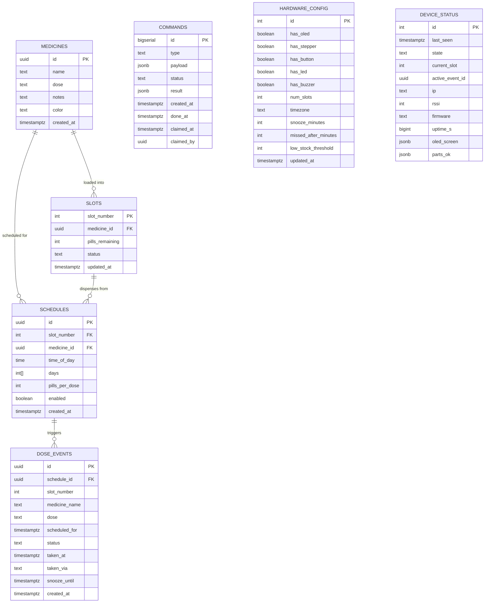

# Database Schema & Data Dictionary

The Sage Bot backend uses Supabase PostgreSQL, Realtime, PostgREST, and Supabase Auth. The web app authenticates as the owner; the ESP32 authenticates as a separate device user.

---

## 📊 Entity Relationship Diagram



---

## 🗃️ Data Dictionary

### 1. `medicines`
Stores medication names, strengths, instructions, and UI color badges.

| Column | Type | Constraints | Default | Description |
|---|---|---|---|---|
| `id` | `uuid` | `PRIMARY KEY` | `gen_random_uuid()` | Unique medicine identifier |
| `name` | `text` | `NOT NULL` | — | Prescription name (e.g. "Metformin") |
| `dose` | `text` | — | `NULL` | Strength / unit (e.g. "500mg", "1 tablet") |
| `notes` | `text` | — | `NULL` | Administration notes (e.g. "Take with food") |
| `color` | `text` | — | `'#14b8a6'` | Hex color code used for UI tags & disc pockets |
| `created_at`| `timestamptz` | — | `now()` | Timestamp of creation |

---

### 2. `slots`
Tracks physical and virtual compartments (1 to 8) on the rotating carousel.

| Column | Type | Constraints | Default | Description |
|---|---|---|---|---|
| `slot_number` | `int` | `PRIMARY KEY`, `CHECK (between 1 and 8)` | — | Compartment number (1 to 8) |
| `medicine_id` | `uuid` | `REFERENCES medicines(id) ON DELETE SET NULL` | `NULL` | Currently loaded medicine |
| `pills_remaining` | `int` | — | `0` | Count of pills remaining in the compartment |
| `status` | `text` | `CHECK (status IN ('empty', 'loaded'))` | `'empty'` | Physical occupancy status |
| `updated_at` | `timestamptz` | — | `now()` | Last refill or load timestamp |

---

### 3. `schedules`
Defines automated dosage times and day recurrences linked to specific slots.

| Column | Type | Constraints | Default | Description |
|---|---|---|---|---|
| `id` | `uuid` | `PRIMARY KEY` | `gen_random_uuid()` | Unique schedule identifier |
| `slot_number` | `int` | `REFERENCES slots(slot_number) ON DELETE CASCADE` | — | Target compartment to dispense |
| `medicine_id` | `uuid` | `REFERENCES medicines(id) ON DELETE SET NULL` | `NULL` | Cached reference to loaded medicine |
| `time_of_day` | `time` | `NOT NULL` | — | Local time of dispensation (`HH:MM:SS`) |
| `days` | `int[]` | `NOT NULL` | `'{0,1,2,3,4,5,6}'` | Active weekdays (0=Sunday, 1=Monday... 6=Saturday) |
| `pills_per_dose`| `int` | — | `1` | Number of pills to decrement and dispense |
| `enabled` | `boolean` | — | `true` | Active switch |
| `created_at` | `timestamptz` | — | `now()` | Created timestamp |

---

### 4. `dose_events`
Individual alarm and dispensing events instantiated per scheduled time.

| Column | Type | Constraints | Default | Description |
|---|---|---|---|---|
| `id` | `uuid` | `PRIMARY KEY` | `gen_random_uuid()` | Event ID |
| `schedule_id`| `uuid` | `REFERENCES schedules(id) ON DELETE SET NULL` | `NULL` | Originating schedule |
| `slot_number`| `int` | — | — | Target slot number |
| `medicine_name`| `text` | — | — | Snapshot of medicine name at alarm time |
| `dose` | `text` | — | — | Snapshot of dose strength at alarm time |
| `scheduled_for`| `timestamptz`| `NOT NULL` | — | Scheduled UTC trigger timestamp |
| `status` | `text` | `CHECK (status IN ('due','taken','missed','skipped','snoozed'))` | `'due'` | Current event lifecycle state |
| `taken_at` | `timestamptz`| — | `NULL` | UTC timestamp when marked taken |
| `taken_via` | `text` | `CHECK (taken_via IN ('button','website','simulator'))` | `NULL` | Channel used to acknowledge dose |
| `snooze_until`| `timestamptz`| — | `NULL` | UTC repeat timestamp if snoozed |
| `created_at` | `timestamptz`| — | `now()` | Record creation timestamp |

*Note: Enforces a unique constraint on `(schedule_id, scheduled_for)` to prevent duplicate triggers.*

---

### 5. `commands`
Asynchronous message queue for website-to-device remote control.

| Column | Type | Constraints | Default | Description |
|---|---|---|---|---|
| `id` | `bigserial`| `PRIMARY KEY` | Sequence | Monotonically increasing command ID |
| `type` | `text` | `NOT NULL` | — | Command verb (e.g. `rotate_to_slot`, `test_oled`) |
| `payload` | `jsonb` | — | `'{}'` | Arguments (e.g. `{"slot": 3, "mode": "dispense"}`) |
| `status` | `text` | `CHECK (status IN ('pending','running','done','failed','simulated'))` | `'pending'` | Current processing stage |
| `result` | `jsonb` | — | `NULL` | Execution output from device or simulator |
| `created_at` | `timestamptz`| — | `now()` | Enqueue timestamp |
| `done_at` | `timestamptz`| — | `NULL` | Completion timestamp |
| `claimed_at` | `timestamptz` | `NULL` | Lease time for an atomically claimed command |
| `claimed_by` | `uuid` | `NULL` | Auth user that owns the active command lease |

---

### 6. `hardware_config`
Single configuration row (`id = 1`) managing peripheral availability and operational thresholds.

| Column | Type | Default | Description |
|---|---|---|---|
| `id` | `int` | `1` (Constraint `id = 1`) | Single-row singleton enforcement |
| `has_oled` | `boolean` | `true` | SSD1306 0.96" display toggle |
| `has_stepper` | `boolean` | `false` | Stepper motor & disc indexing toggle |
| `has_button` | `boolean` | `false` | Physical acknowledge push button toggle |
| `has_led` | `boolean` | `false` | Physical status LED toggle |
| `has_buzzer` | `boolean` | `false` | Physical audio buzzer toggle |
| `num_slots` | `int` | `8` (`CHECK between 4 and 8`) | Total active compartments configured |
| `timezone` | `text` | `'Asia/Kolkata'` | IANA timezone for local schedule calculations |
| `snooze_minutes`| `int` | `10` | Default snooze interval |
| `missed_after_minutes`| `int`| `30` | Minutes before an unacknowledged alarm becomes `missed` |
| `low_stock_threshold`| `int` | `3` | Pill threshold triggering amber refill warnings |
| `updated_at` | `timestamptz`| `now()` | Timestamp of last setting change |

---

### 7. `device_status`
Single telemetry row (`id = 1`) updated every 10 seconds by the physical device or simulator.

| Column | Type | Description |
|---|---|---|
| `id` | `int` | Single row (`id = 1`) |
| `last_seen` | `timestamptz` | Heartbeat timestamp (online if within 30 seconds) |
| `state` | `text` | Operational state: `'idle'`, `'alarm'`, `'loading'`, `'moving'`, `'offline'` |
| `current_slot` | `int` | Current compartment indexed under the chute (1 to 8) |
| `active_event_id` | `uuid` | Foreign reference to currently active `dose_events.id` |
| `ip` | `text` | Local device IP address on Wi-Fi |
| `rssi` | `int` | Wi-Fi signal strength in dBm (e.g. `-55`) |
| `firmware` | `text` | Firmware version string (e.g. `'v1.0.0-esp32'` or `'simulator'`) |
| `uptime_s` | `bigint` | Device uptime in seconds |
| `oled_screen` | `jsonb` | Exact mirror of physical screen: `{"screen": "home", "lines": [...]}` |
| `parts_ok` | `jsonb` | Self-diagnostic map: `{"oled": true, "stepper": false, ...}` |

---

## Row-Level Security

The initialization migration enables RLS without creating public policies. The secure-access migration creates the singleton `app_access` mapping and owner/device policies. Create the two Auth users and set their UUIDs in `app_access` before use. The owner can read/write application data; the device has only the reads, telemetry update, and RPC permissions needed by firmware. Anonymous access is revoked.

`claim_next_command`, `complete_device_command`, `mark_dose_taken`, and `resolve_device_dose` are security-definer RPCs with explicit owner/device authorization. Command claiming uses a row lock and expiring lease; dose acknowledgement and inventory decrement occur in one transaction.

---

## 📡 Realtime Publication

To enable instant WebSocket event push to the frontend, all tables are published to `supabase_realtime`:

```sql
alter publication supabase_realtime add table 
  device_status, commands, dose_events, slots, hardware_config, schedules, medicines;
```
