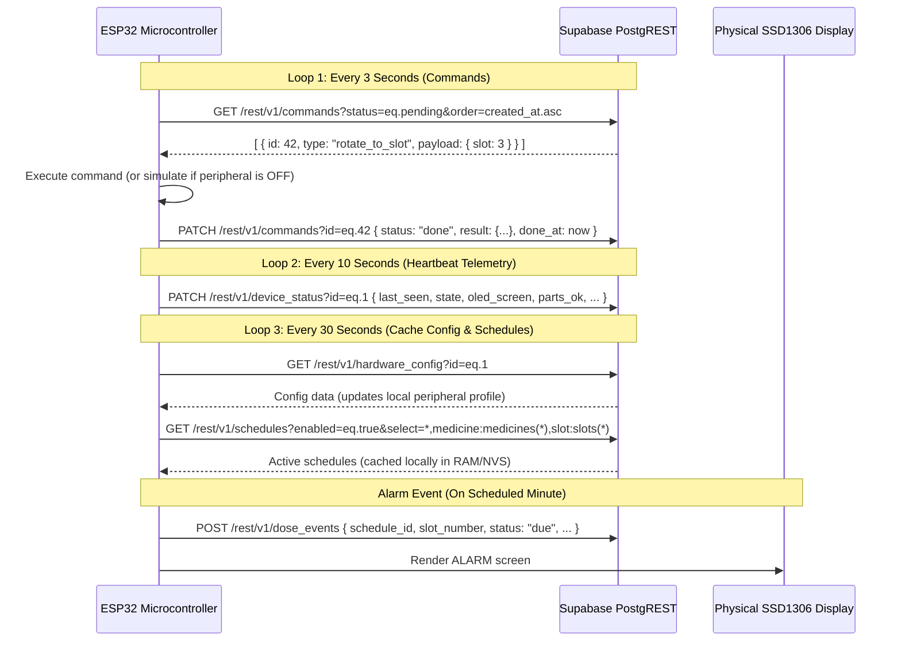

# ESP32 Device Firmware Contract

This document provides the exact technical specification for developing the **ESP32 C++ / Arduino / ESP-IDF firmware**. The microcontroller interacts directly with Supabase via HTTP REST (PostgREST) using the anonymous public key.

---

## 🔑 Authentication & Headers

Every HTTP request from the ESP32 to Supabase MUST include the following headers:

```http
apikey: <SUPABASE_ANON_KEY>
Authorization: Bearer <SUPABASE_ANON_KEY>
Content-Type: application/json
Prefer: return=minimal
```

- Base URL: `https://<YOUR-PROJECT-ID>.supabase.co`
- REST Endpoint Prefix: `/rest/v1`

---

## ⏱️ Firmware Polling & Telemetry Loops



---

## 1. Loop 1: Command Execution (Every 3 Seconds)

### Request: Fetch Pending Commands
```http
GET /rest/v1/commands?status=eq.pending&order=created_at.asc HTTP/1.1
Host: <PROJECT-ID>.supabase.co
apikey: <ANON_KEY>
Authorization: Bearer <ANON_KEY>
```

### Command Types & Implementation Logic

| Command Type | Payload Example | Hardware Behavior | Missing Peripheral Fallback |
|---|---|---|---|
| `rotate_to_slot` | `{"slot": 3, "mode": "dispense"}` | Energizes ULN2003 steps to index Slot 3 under chute. | Set status to `simulated`. Set OLED screen to `loading` (`"LOAD SLOT 3"`). |
| `load_done` | `{"slot": 3}` | Confirms compartment loaded. Updates OLED to `"Slot 3 loaded"`. | Always succeeds. Set status to `done`. |
| `home` | `{}` | Rotates motor until Hall sensor reads LOW on D33. Sets position = 1. | Set status to `simulated`. Set position = 1. |
| `show_message` | `{"lines": ["Line 1", "Line 2"], "seconds": 5}` | Displays text on OLED for N seconds, then returns to home screen. | If OLED is OFF, set status to `simulated`. |
| `stop_alarm` | `{"event_id": "<uuid>"}` | Cancels active buzzer and LED signaling; sets OLED back to home. | Always succeeds. Set status to `done`. |
| `mark_taken` | `{"event_id": "<uuid>"}` | Updates local state to taken. | Set status to `done`. Device patches `dose_events` row. |
| `snooze` | `{"event_id": "<uuid>", "minutes": 10}` | Stops buzzer; sets local snooze timer. | Always succeeds. Set status to `done`. |
| `skip` | `{"event_id": "<uuid>"}` | Cancels alarm sequence. | Always succeeds. Set status to `done`. |
| `test_alarm` | `{"slot": 1}` | Runs the complete alarm sequence using whatever hardware is ON. | Always succeeds. Set status to `done`. |
| `test_<part>` | `{}` | Runs individual peripheral test routine. | If peripheral flag is `false`, mark status as `simulated`. |

### Response: Acknowledge & Update Command
```http
PATCH /rest/v1/commands?id=eq.<id> HTTP/1.1
Host: <PROJECT-ID>.supabase.co
apikey: <ANON_KEY>
Authorization: Bearer <ANON_KEY>
Content-Type: application/json

{
  "status": "done",
  "result": { "ok": true, "note": "disc indexed to slot 3" },
  "done_at": "2026-10-13T08:30:15Z"
}
```
*(Use status `"simulated"` if the required module is disabled in `hardware_config`).*

---

## 2. Loop 2: Telemetry Heartbeat (Every 10 Seconds)

The ESP32 updates its telemetry row to maintain the web console's **Online** badge:

```http
PATCH /rest/v1/device_status?id=eq.1 HTTP/1.1
Host: <PROJECT-ID>.supabase.co
apikey: <ANON_KEY>
Authorization: Bearer <ANON_KEY>
Content-Type: application/json

{
  "last_seen": "2026-10-13T08:30:00Z",
  "state": "idle",
  "current_slot": 1,
  "active_event_id": null,
  "ip": "192.168.1.105",
  "rssi": -58,
  "firmware": "v1.0.0-esp32",
  "uptime_s": 3600,
  "oled_screen": {
    "screen": "home",
    "lines": ["10:42", "Tue 13 Oct", "Next: Metformin 13:00 S3"]
  },
  "parts_ok": {
    "oled": true,
    "stepper": false,
    "hall": false,
    "ir": false,
    "servo": false,
    "button": false,
    "led": false,
    "buzzer": false
  }
}
```

---

## 3. Loop 3: Cache Hardware Config & Schedules (Every 30 Seconds)

### Fetch Config
```http
GET /rest/v1/hardware_config?id=eq.1 HTTP/1.1
Host: <PROJECT-ID>.supabase.co
apikey: <ANON_KEY>
Authorization: Bearer <ANON_KEY>
```
*The ESP32 updates its internal boolean flags (`has_oled`, `has_stepper`, etc.) directly from this response. Toggling options on the website takes effect within 30 seconds without re-flashing.*

### Fetch Active Schedules
```http
GET /rest/v1/schedules?enabled=eq.true&select=*,medicine:medicines(*),slot:slots(*) HTTP/1.1
Host: <PROJECT-ID>.supabase.co
apikey: <ANON_KEY>
Authorization: Bearer <ANON_KEY>
```
*Stores schedules in local RAM. If Wi-Fi drops, the ESP32 continues running reminders autonomously using its internal RTC/NTP time.*

---

## 4. OLED Display Screen Layouts

The `oled_screen` field mirrors the 128x64 display for the web preview. The firmware must update this JSON whenever its physical screen state changes:

1. **`boot`**: `["Sage Bot", "Starting..."]`
2. **`home`**: `["10:42", "Tue 13 Oct", "Next: Metformin 13:00 S3"]` (or `"No doses today"`)
3. **`alarm`**: `["TAKE MEDICINE", "<Medicine Name>", "<Dose> Slot <N>", "Press button" | "Mark taken in app"]`
4. **`taken`**: `["Dose taken", "<Medicine Name>"]` (Displays for 3 seconds)
5. **`missed`**: `["Missed dose", "<Medicine Name>", "13:00"]`
6. **`loading`**: `["LOAD SLOT <N>", "<Medicine Name>", "Tap Done in app"]`
7. **`moving`**: `["Moving disc", "to slot <N>"]`
8. **`message`**: Up to 3 custom lines sent via `show_message` command
9. **`error`**: `["Device error", "<Error Code>", "<Hint>"]`
10. **`wifi`**: `["Connecting WiFi...", "Open setup page"]`
