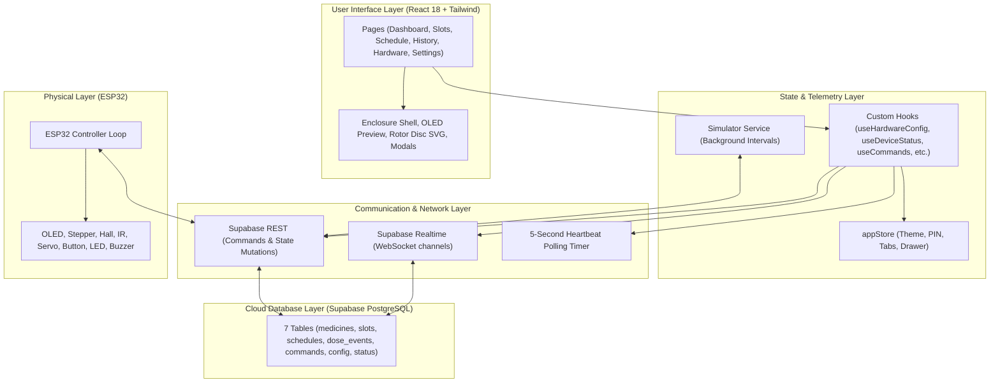
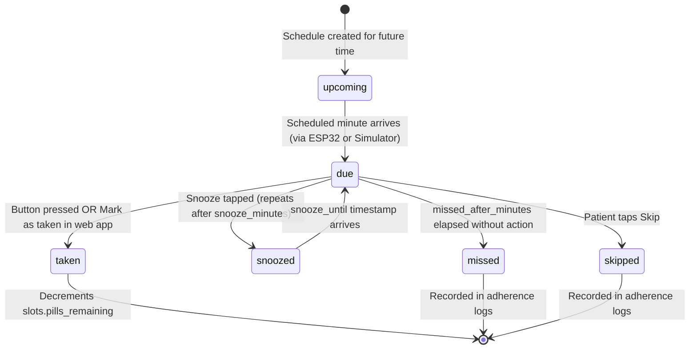
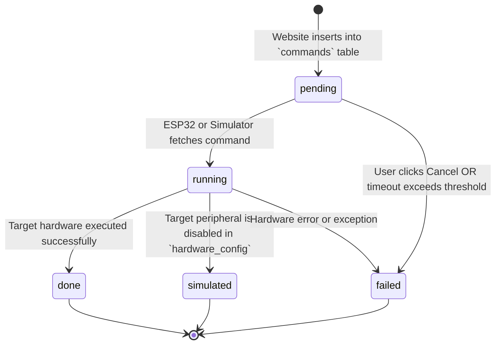

# System Architecture & Technical Design

This document details the software architecture, state machines, and data pipelines of the **Sage Bot 2.0** ecosystem.

---

## 🏗️ Layered Architecture

---

## 🔄 State Machines

### 1. Dose Event Lifecycle
Every dose originates from an enabled schedule and transitions through a deterministic state machine:

- **Pill Decrementing**: When an event transitions to `taken`, the system automatically decrements `slots.pills_remaining` by `pills_per_dose` exactly once. If the remaining count falls below `low_stock_threshold`, an alert toast is raised.

---

### 2. Command Pipeline Lifecycle
Outbound commands from the website to the physical device follow this pipeline:

- **Stuck Detection**: If a command remains in `pending` or `running` state for longer than **20 seconds**, the UI flags `"Device not responding"` and provides **Retry** and **Cancel** controls.

---

## 🔌 Dual Controller Synchronization

Sage Bot operates with either physical hardware or a virtual simulator:

| Event | Physical ESP32 Present | In-Browser Simulator Active |
|---|---|---|
| **Heartbeat Frequency** | Updates `device_status` every 10s via HTTP PATCH. | Updates `device_status` every 10s via client timer. |
| **Firmware Identification** | Reports version (e.g. `v1.0.0-esp32`). | Reports firmware as `'simulator'`. |
| **Command Processing** | Polls every 3s; executes physical GPIO transitions. | Polls every 3s; simulates steps and writes result JSON. |
| **Schedule Triggering** | Evaluates local RTC/NTP time every 30s. | Evaluates browser system clock in configured timezone. |
| **Precedence Policy** | **Highest**. When online, physically executes movements. | **Secondary**. If physical device checks in, simulator immediately turns OFF. |
